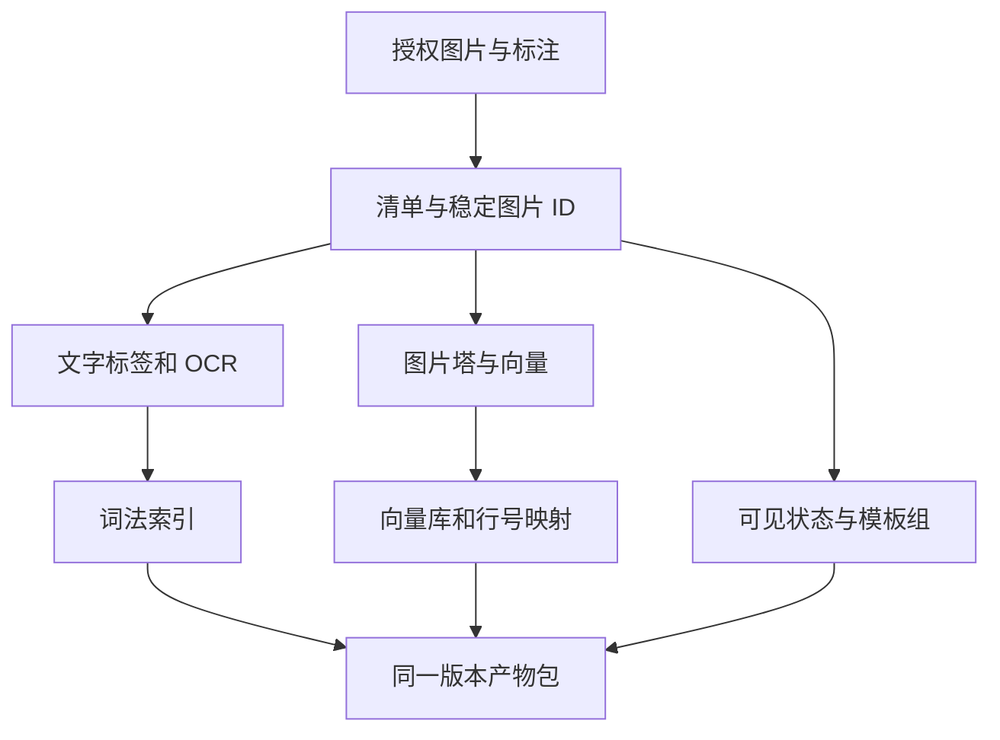

# 03 · 架构：一个中文查询怎样变成可展示的表情包列表

> 读完能画两张图：后台怎样从素材构建索引；一条请求怎样查两路、融合、过滤并返回。图中的词法、融合和离线评测已有实现，其余是工程设计练习。

## 3.1 场景、输入和责任

用户在输入框里搜台词、情绪或画面特征，希望较早看到一张可发的图。系统应保护三个事实：图是谁、此刻能不能展示、为什么排到这个位置。对应三种数据：稳定图片 ID、可见性状态与分路证据。把路径直接当 ID 可能在文件移动后断裂；把分数当可见性会允许下架图出现；只返回最终 ID 不留证据会难定位错误。

## 3.2 离线流程：让所有产物使用同一个 ID



图中的 OCR 是可选信号。用人手标签也可以建词法库，但必须留下信号来源。对动画要知道现有代码只读首帧，若关键表情在第二秒出现，首帧根本没有信息。匹配列表使用稳定 ID，行号只是文件里的当前位置。图文模型和词法可以分别升级，**上线时需要一个能包含这两个版本号以及目录版本的组合**，以便复盘。

| 产物 | 键和关键字段 | 检查 |
|---|---|---|
| manifest | id、text、image | 重复 ID、相对路径、图文件可读 |
| 词法统计 | doc→TF，term→DF，avgdl | tokenizer 与查询一致 |
| 向量库 | 行号、D 维向量、id | 数量、模型、归一化与度量一致 |
| 元数据 | id、模板族、状态、展示地址 | 支持过滤、回填与去重 |
| 评测标签 | 查询、图 ID、正例集合 | 不能把旧库标签当新库同义映射 |

## 3.3 在线流程：顺序错误会影响最终结果

```text
中文查询“累成狗”
  ├─ 规范化 → 文本 tokens → 查词法；可为空
  └─ 模型 tokenizer → 文字向量 → 查图像库；按余弦给名次
                           │
                 合并候选并保留路级排名
                           │
              过滤下架；按模板去重；回填
                           │
                按最终预算取展示 TopK
```

为什么过滤放在合并后也要留质量记录？设词法给 [A,B]、视觉给 [C,A]，A 已下架。如果只取最终 K=2 再过滤，常出现剩一条。先过滤/保留足够深度再展示，可以回填，但需要测更多候选开销。去重不仅是列表美化，有时会让多个 ID 归到同一代表图；评测单位也应同步。队友调了过滤规则导致列表变短，不能把指标变化都归给图文模型。

在仓库基线中，[demo.py](../../scripts/demo.py) 只运行词法，不含实际服务和索引；[clip_search.py](../../scripts/clip_search.py) 是能接模型的命令行脚本。要上线再添加授权素材管理、离线索引、缓存和服务监控，避免用演示逻辑伪装吞吐。

## 3.4 用一个失败请求检查设计职责

```text
query: 困成狗了
候选词法：[D18 狗开心, D23 狗睡觉]
候选图文：[D42 打哈欠, D41 趴着睡, D18]
融合输出：[D18,D23,D42,D41]（仅作假想例）
准入过滤：[D18,D23,D41]，D42 不可见
展示输出：[D18,D23]，K=2
```

如果只看最终输出，很容易误以为向量没有识别座位姿态。实际语义路已检出两个，D42 被业务过滤，D41 则排序靠后。下一步不应取消可见性来换指标；用相同可见库对照语义意图的保留位，看看 D41 能否在固定首屏位置数时被保留，再检查「小狗跳舞」等字面实体是否退化。

## 3.5 设计一条可复盘的记录

同一请求可以从分路保存候选 ID、路级分数、索引版本与是否超时，从合并保存去重理由与最终顺序。只记必要字段，分析语料与真实隐私日志分开。发新索引前在一批固定查询上对照映射和可见状态；出问题回滚整个版本包。高并发时完整逐词日志开销大，可抽样或用命令离线重现。

<details>
<summary>面试题：你会如何证实“有多路”而不只是画了多路架构？</summary>

提供各路独立榜、去重后的唯一候选、每路独有正例和最终榜。在 [实战](../12-project-labs/README.md) 中现有视觉候选是手填的，所以只能验证接口与融合原理。完成授权图库实验后，才报告真实图文路效果。
</details>

---
[返回首页](../../README.md) · [上一章](../02-project-selection/README.md) · [下一章](../04-source-walkthrough/README.md)
