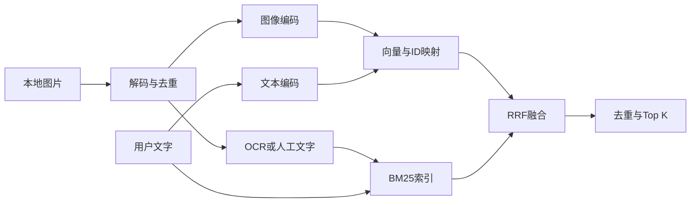

# 03 · 端到端架构与数据流

离线任务处理图片，在线任务只处理查询。大图解码不能出现在每次线上检索的关键路径里。本仓库的可选脚本为了阅读简单，每次重新编码图库；这是教学限制，下一步需要把图片向量缓存到磁盘。

每条索引记录包含 `image_id, file_sha256, relative_path, model_revision, preprocessing_version, embedding`。不能仅凭向量维度判断两批向量可混用：不同模型即使维度相同，空间也可能完全不一致。

更新流程采用“构建新目录 → 完整性检查 → 原子切换版本指针”。删除图片时同时更新词法索引、向量ID映射、缓存，否则可能返回已经不存在的资源。

## 复杂度与容量

精确检索为 O(Nd)。N=10,000、d=512、float32 时，仅向量约 20.48 MB，不含模型、路径和其他索引。百万规模同一配置约 2.048 GB，ANN索引还会有额外开销。容量估计应写出单位及包含项。

验收：画出模型升级过程，解释旧索引如何回滚，说明缺图和损坏图如何处理。

---
[返回首页](../../README.md) · [上一章](../02-project-selection/README.md) · [下一章](../04-source-walkthrough/README.md)
